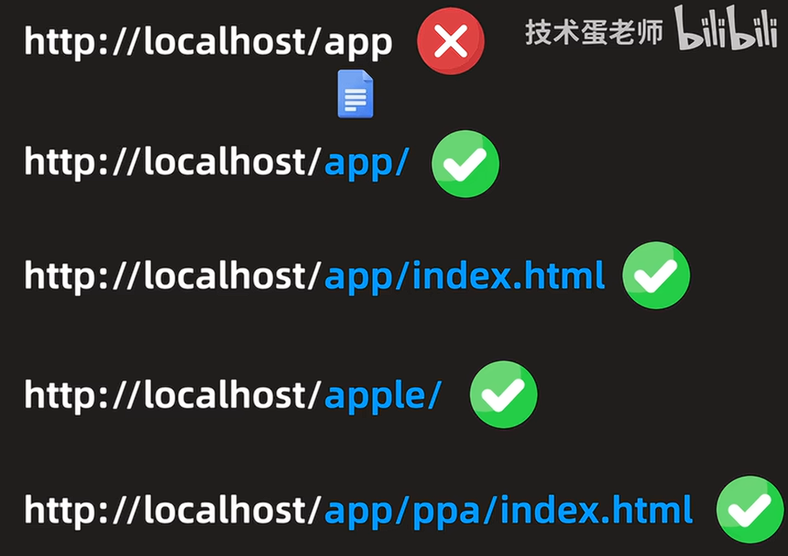
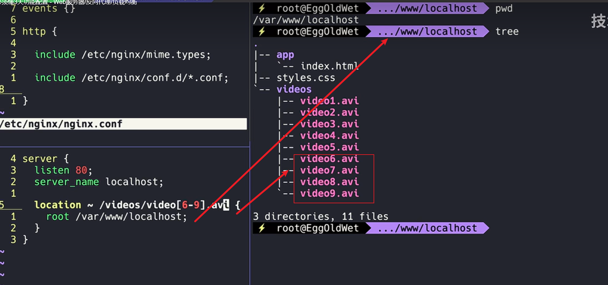
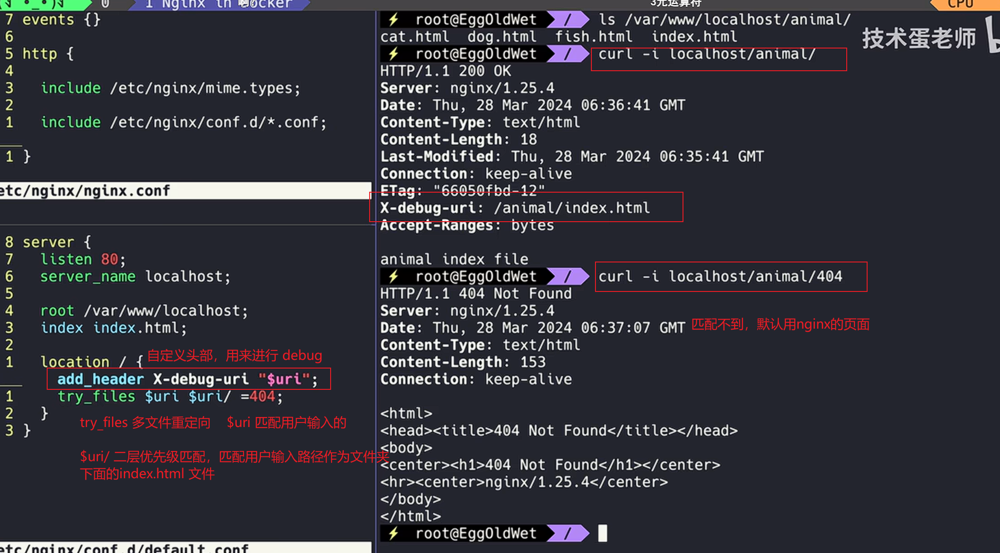
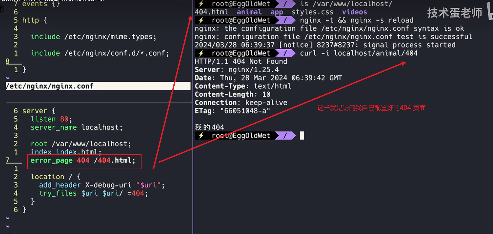
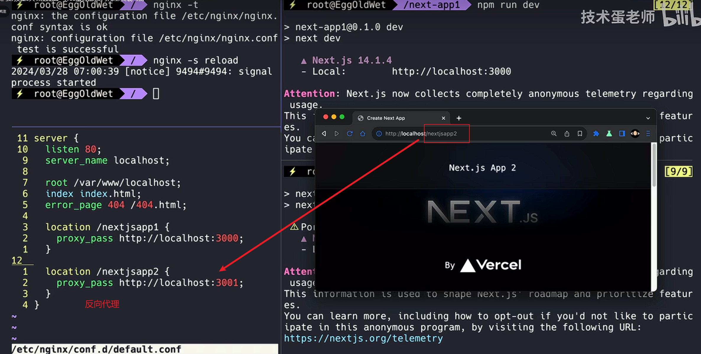
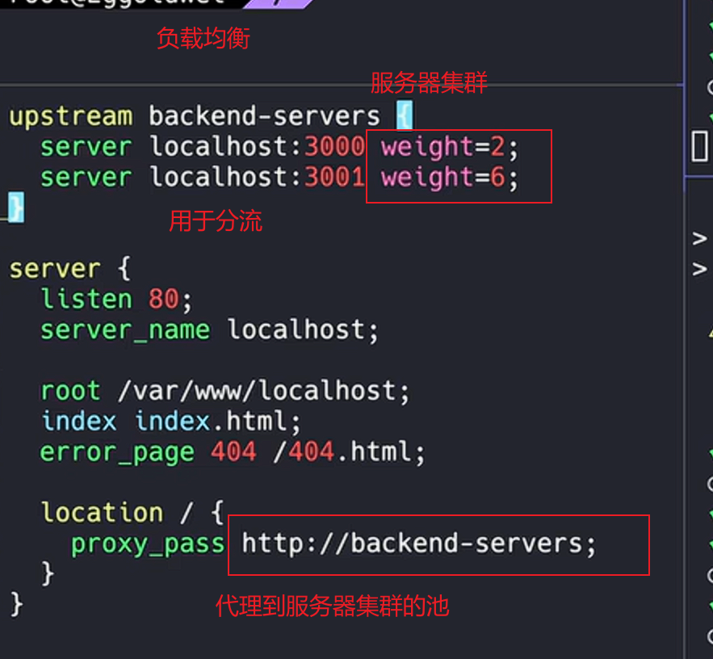

## Nginx 网络访问

1. 修改配置之后

   ```
   nginx -t && nginx -s reload
   ```
2. location命令

```
server{
 listen 80;
 server_name localhost;
 
 location /app {  
     root /var/www/localhost
 }
}
// 这种只能访问  http://localhost/app 开头的文件    location 参数 /app  ，不填写，nginx 会匹配 app 开头的uri 与 文件路径；

```



匹配太广，容易暴露其他的文件；

```
location = /app/index.html{
}

// 访问完全相等
```



curl -i localhost/videos/video9.avi  是啥意思





## 反向代理



## 负载均衡




nginx 配置


